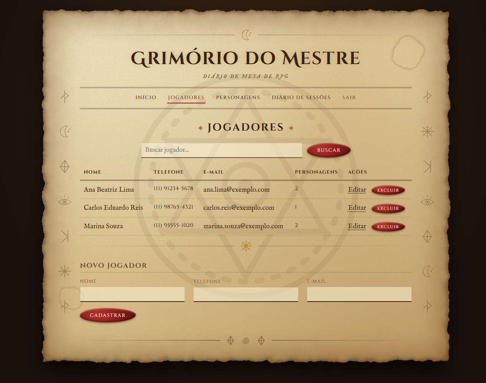
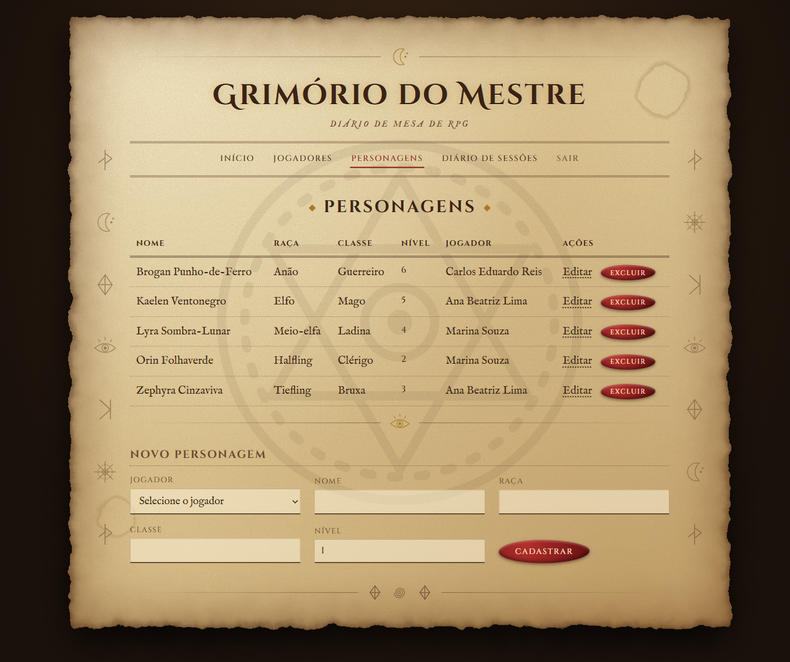
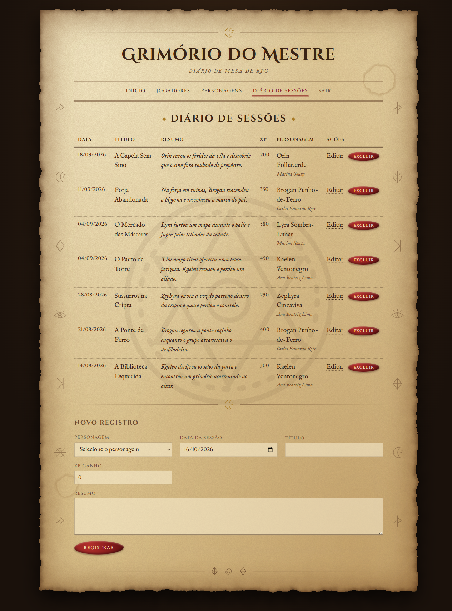
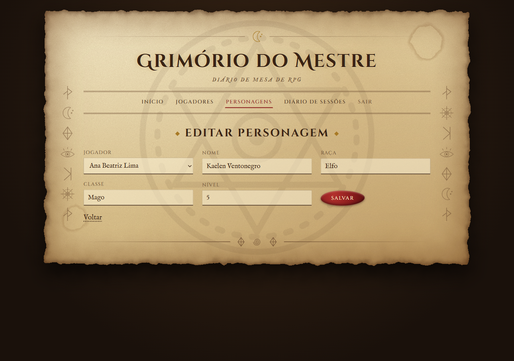

# Grimório do Mestre

Diário de mesa de RPG feito para o desafio "sua cara no código". É o sistema da oficina e da clínica com a mesma estrutura, contando outra história: jogadores guardam personagens, e cada personagem escreve o que viveu nas sessões. O visual é de pergaminho, com glifos mágicos desenhados em SVG.

## O que tem

- Login com usuário e senha (tabela `usuarios`, sem relacionamento)
- Tela principal com o nome de quem entrou e o botão de sair
- **Jogadores** (tabela 1), com busca por nome
- **Personagens** (tabela 2), cada um pertence a um jogador
- **Diário de Sessões** (tabela 3), cada registro pertence a um personagem, listado por data
- Cadastrar, listar, editar e excluir em todas as tabelas
- 3 ou mais registros em cada tabela no `saep_db.sql`

Relacionamentos: `jogador` 1:N `personagem` 1:N `registro_sessao`. Excluir um jogador apaga os personagens e os registros dele (`ON DELETE CASCADE`). O DER está em [DER.svg](DER.svg).

## Como rodar

Precisa de PHP com `mysqli` e MySQL ou MariaDB.

1. Importe o banco (ele cria o `diario_rpg`):

   ```bash
   mysql -u root -p < saep_db.sql
   ```

2. Copie `sistema/config.exemplo.php` para `sistema/config.php` e coloque a senha do seu MySQL.

3. Coloque a pasta `sistema` no servidor (por exemplo `htdocs` do XAMPP) ou rode direto:

   ```bash
   php -S localhost:8099 -t sistema
   ```

4. Abra `http://localhost:8099` e entre com o usuário de teste: `mestre` / `grimorio`.

## Estrutura

```
sistema/        páginas PHP, css/style.css e inc/ (topo, rodapé, glifos, sessão)
saep_db.sql     banco com as tabelas e os dados de exemplo
DER.svg         diagrama entidade-relacionamento
prints/         telas do sistema
```

## Telas

| Login | Principal |
|---|---|
|  |  |

| Jogadores | Personagens |
|---|---|
|  |  |

| Diário de Sessões | Edição |
|---|---|
|  |  |

## Tecnologias

PHP (mysqli com consultas preparadas), MySQL, HTML e CSS puro. Fontes Cinzel e IM Fell English, do Google Fonts.
